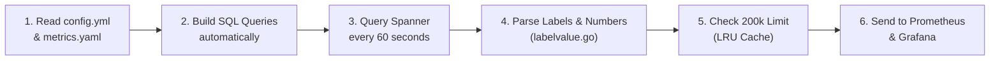
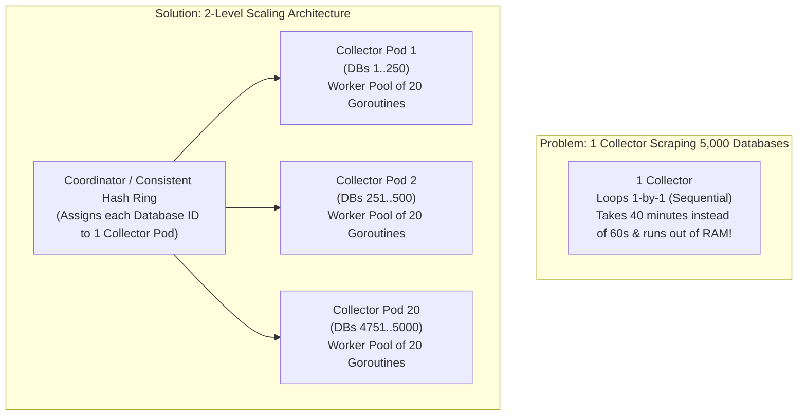

# Super Simple Interview Guide: Your OpenTelemetry Spanner Project

Everything in this guide is written in **plain, everyday English**—no heavy textbook words.
For every question, you get:
- **In Simple Words**: So you understand *why* it works that way in 10 seconds.
- **What to Say in the Interview**: Natural, easy sentences you can speak out loud.

---

## 1. The Big Picture: What Is This Project?

### Q1: "Tell me about your project."
* **In Simple Words:**
  - **Google Cloud Spanner** is Google's huge database.
  - Inside Spanner, there are built-in system tables called `SPANNER_SYS` that record what the database is doing—like which queries are slow, which transactions are locking tables, and how much data is being written.
  - **The Problem**: Spanner deletes this data after a short time, and you can't easily see it on graphs in tools like **Prometheus** or **Grafana**.
  - **The Solution (Our Receiver)**: We work on a tool called the **OpenTelemetry Spanner Receiver** (written in **Go**). Every **60 seconds**, it runs SQL queries on Spanner's `SPANNER_SYS` tables, cleans up the data, and sends it out as metrics so engineers can see live graphs and tables in **Prometheus**, **Grafana**, or **Google Cloud Monitoring**.
  - **What You Built**:
    1. You added support for new Spanner system tables (like Active Partitioned DMLs, Row Deletion Policies, Supported Optimizer Versions, and Oldest Active Queries).
    2. You wrote Go code to parse tricky JSON columns (like `operations_by_table_json` and `lock_requests_json`) so they work for both **GoogleSQL** and **PostgreSQL** databases.
    3. You built and fixed the **Grafana dashboards** so engineers can see these metrics in clean tables.

* **What to Say in the Interview:**
  > "I contributed to the **Google Cloud Spanner Receiver** in the open-source **OpenTelemetry Collector** repo, which is written in **Go**.
  >
  > Cloud Spanner has internal system tables called `SPANNER_SYS` that track slow queries, lock waits, and transaction stats, but that data stays inside the database and expires quickly.
  >
  > Our receiver wakes up every 60 seconds, queries those `SPANNER_SYS` tables, converts the rows into standard OpenTelemetry metrics, and exports them to **Prometheus, Grafana, and Google Cloud Monitoring**.
  >
  > Specifically, I added new system table metrics, wrote custom JSON parsers in Go (`operations_by_table_json` and `lock_requests_json`) so the receiver supports both GoogleSQL and PostgreSQL databases, wrote unit tests with 100% coverage, and built the Grafana dashboard tables."

---

## 2. How the Receiver Works (Step-by-Step)

### Q2: "How does your receiver actually work from start to finish?"
* **In Simple Words:**
  Think of the receiver like a **1-minute alarm clock**:
  1. **Read Config (`config.go`)**: When it starts, it reads `config.yml` to see which Spanner databases to watch and how often to run (every 60 seconds).
  2. **Read `metrics.yaml`**: Instead of writing 30 SQL queries in Go code, all the table names, label columns, and metric columns are listed in one YAML file (`metrics.yaml`). The Go code reads this file and automatically builds the `SELECT ... FROM SPANNER_SYS...` SQL queries.
  3. **Run SQL on Spanner (`statsreader`)**: Every 60 seconds, it connects to Spanner and runs those SQL queries.
  4. **Clean & Convert Rows (`labelvalue.go`)**: For every row Spanner returns, it converts the columns into **Labels** (text info like `database="mydb"`, `table="Singers"`) and **Metric Values** (numbers like `latency=5.2`, `commit_count=10`).
  5. **Check Quota Limit (Cardinality Filter)**: It checks a cache to make sure we aren't sending too many unique rows and breaking Google Cloud's 200,000 limit.
  6. **Send Out**: It hands the metrics to the Collector pipeline to send to Prometheus or Google Cloud.



---

### Q3: "What is the difference between `IntervalStatsReader` and `CurrentStatsReader`?"
* **In Simple Words:**
  Spanner has two kinds of system tables:
  1. **1-Minute History Tables (`IntervalStatsReader` — `intervalstatsreader.go`)**:
     - Tables like `TXN_STATS_TOP_MINUTE` or `LOCK_STATS_TOP_MINUTE` save stats in **1-minute buckets** and have a column called `INTERVAL_END` (e.g., `12:01:00`, `12:02:00`).
     - Our query needs `WHERE INTERVAL_END = @pullTimestamp` so it asks for a specific minute.
  2. **Right-Now Snapshot Tables (`CurrentStatsReader` — `currentstatsreader.go`)**:
     - Tables you worked on like `ACTIVE_PARTITIONED_DMLS`, `OLDEST_ACTIVE_QUERIES`, and `ROW_DELETION_POLICIES` only show what is happening **right this second**. They do **not** have an `INTERVAL_END` column.
     - How does the code know which reader to use? In `metrics.yaml`, if you write `timestamp_column_name: "INTERVAL_END"`, it uses `IntervalStatsReader`. If you leave `timestamp_column_name` out, it uses `CurrentStatsReader` and stamps the metric with the current clock time (`time.Now()`).

---

## 3. Questions About the Code You Wrote (`labelvalue.go`)

### Q4: "Why did Spanner add JSON string columns (`OPERATIONS_BY_TABLE_JSON_STRING` and `SAMPLE_LOCK_REQUESTS_JSON_STRING`)?"
* **In Simple Words:**
  - Spanner supports two SQL languages: **GoogleSQL** and **PostgreSQL**.
  - Older columns used `ARRAY<STRUCT>` (a list of objects), which works in GoogleSQL, but **PostgreSQL doesn't support `ARRAY<STRUCT>`** in `SPANNER_SYS`.
  - So Spanner added a plain JSON text column (`[{"table_name":"t1", "insert_or_update_count":1, "insert_or_update_bytes":10}]`) because **both GoogleSQL and PostgreSQL support JSON strings**.

---

### Q5: "Why didn't you just send the raw JSON string as the label? Why did you write `newOperationsByTableJSONLabelValue` to parse and sort it?"
* **In Simple Words (4 Easy Reasons):**
  1. **Uppercase vs Lowercase Keys**:
     - GoogleSQL gives uppercase keys: `{"TABLE_NAME": "t1", ...}`
     - PostgreSQL gives lowercase keys: `{"table_name": "t1", ...}`
     - When we parse it with Go's `json.Unmarshal`, Go matches both uppercase and lowercase automatically and turns both into the exact same format: `{t1,1,10}`.
  2. **Order Can Change (Sorting is Critical!)**:
     - In Minute 1, Spanner might return `[table2, table1]`. In Minute 2, it might return `[table1, table2]`.
     - If we don't sort them, Prometheus thinks `[table2, table1]` and `[table1, table2]` are **two completely different metrics**! Sorting them alphabetically (`{table1,...},{table2,...}`) guarantees the label is always identical.
  3. **Removing Duplicates**:
     - If the JSON array accidentally lists the same entry twice, our Go map (`uniqueValueItems`) removes the duplicate.
  4. **Making the Text Shorter**:
     - Repeating `"INSERT_OR_UPDATE_COUNT":` and `"INSERT_OR_UPDATE_BYTES":` for every table wastes tons of characters (and Cloud Monitoring cuts off labels over 1,024 characters). Turning it into `{t1,1,10},{t2,2,20}` makes it short and clean to read in Grafana.

---

### Q6: "Walk me through your function `newOperationsByTableJSONLabelValue` step by step."
* **In Simple Words:**
  1. **Get the string**: Grab the raw JSON string that came back from Spanner.
  2. **Parse JSON (`json.Unmarshal`)**: Turn the JSON text into a list of Go structs (`[]*operationsByTableJSON`). If the JSON is broken or empty, don't crash—just return an empty string `""`.
  3. **Loop and Skip Bad Items**:
     - If an item is `null` or its `table_name` is empty `""`, skip it (`continue`).
     - *Good detail to mention*: If a list has one bad item and one good item (like `[null, {"table_name":"t1",...}]`), skipping with `continue` throws away the `null` item and **keeps the good `t1` item**!
     - What if `table_name` is `"HotspotTable"`, and the counts are `0` (for example, a `DELETE` transaction)? Because `table_name` is not empty, we keep `{HotspotTable,0,0}` so engineers still see which table was touched.
  4. **Deduplicate**: Put each formatted `{table,count,bytes}` string into a Go map (`map[string]struct{}`) so duplicates are ignored.
  5. **Sort and Join**: Put the unique strings into a slice, sort them A-to-Z with `sort.Strings()`, and join them with commas (`strings.Join(..., ",")`).

---

### Q7: "Why did you use `map[string]struct{}` instead of `map[string]bool` to remove duplicates?"
* **In Simple Words:**
  - We only care about the **keys** in the map (to see if a string is already there); we don't care about the value.
  - In Go, a `bool` (`true`/`false`) takes **1 byte** of memory for every item.
  - An empty struct `struct{}{}` takes **0 bytes** of memory! So `map[string]struct{}` is the standard Go trick to make a "Set" without wasting any memory.

---

## 4. High Cardinality & Security (PII) Questions

### Q8: "What is 'Cardinality', why is High Cardinality bad, and how does this project fix it?"
* **In Simple Words:**
  - **What is Cardinality?** Every time a metric has a new combination of labels (like a new SQL query text or a new lock key), Prometheus and Google Cloud Monitoring create a **new row (time series)** in their database. "Cardinality" just means **"how many unique rows/time series exist."**
  - **Why is High Cardinality bad?** Google Cloud Monitoring has a strict limit of **200,000 time series per project in 24 hours**. If customers run thousands of different SQL queries every minute and we send all of them, we will hit 200,000 in an hour, and Google Cloud will **block/drop all our metrics** for the rest of the day!
  - **How our Receiver fixes it (`itemcardinality.go`):**
    1. Suppose one metric is allowed **7,691** time series per 24 hours.
    2. There are **1,440 minutes** in 24 hours (`60 minutes × 24 hours = 1440`).
    3. Divide `7,691 / 1,440` = **5 new series per minute**.
    4. We keep a **24-hour memory cache (LRU cache)** of every label combination we have already sent today:
       - If we have **already seen** this query/transaction today → let it through! (It doesn't cost a new slot in the 200k limit).
       - If it is a **brand-new** query/transaction we haven't seen today → only let the **top 5 new ones** through this minute, and drop the rest. That way, we never run out of quota early in the day!

---

### Q9: "How does the receiver hide customer PII (private data) in Lock Stats?"
* **In Simple Words:**
  - In lock stats, Spanner reports the primary key of the locked row—like `Users(john@gmail.com, 12345)+`.
  - Email addresses or names are private customer data (**PII**), which companies don't want leaked into monitoring dashboards.
  - When the config flag `hide_top_n_lock_stats_row_range_start_key: true` is turned on, `HideLockStatsRowrangestartkeyPII()` keeps the table name `Users(` and the `+` at the end, but **scrambles (hashes)** the values inside the parentheses into numbers: `Users(2849102, 9182731)+`.
  - **Why keep the table name `Users`?** So engineers can still see *which table* is locked and if the *same* key keeps getting locked (because the same key always hashes to the same number), without ever seeing `"john@gmail.com"`.

---

## 5. Binary, Containers & Docker/Podman (In Simple Words)

### Q10: "What is a 'binary'? Why did we have to build `customcol`?"
* **In Simple Words:**
  - **What is a binary?** The `.go` files you write are just text files (**source code**). A computer's processor only understands 0s and 1s (**machine code**). When you run `go build`, Go compiles all your `.go` text files into one single runnable program file called a **binary** (our `customcol` file).
  - **Why couldn't we just run `receiver.go` by itself?**
    Because our Spanner receiver is just a **plugin/library**, not a full app (it doesn't have `package main` or `func main()`). It's like a car engine—it needs the **OpenTelemetry Collector** body around it to actually run.
  - **How did we build `customcol`?**
    The official Docker container had the old collector binary from GitHub without your new code. So we created a tiny `main.go` + `go.mod` with a `replace` line pointing to your local folder (`receiver/googlecloudspannerreceiver`), and ran `CGO_ENABLED=0 go build` to bake your new code into a fresh binary (`customcol`).

---

### Q11: "Why did you have to use `CGO_ENABLED=0` when building the binary?"
* **In Simple Words:**
  - Normally, when you compile a program on Linux, it assumes the computer running it will have standard Linux C helper files installed (`/lib64/...`). That's called **dynamic linking**.
  - However, the OpenTelemetry Collector container is a super-tiny, stripped-down security container (called a `scratch` or `distroless` container) that has **zero** Linux helper files inside it.
  - When we first copied a normal binary into the container, it crashed immediately because those helper files weren't there!
  - Adding **`CGO_ENABLED=0`** tells Go to pack *everything* inside our single `customcol` file (**static linking**), so it runs inside any empty container without needing anything else.

---

### Q12: "What is a Container, and how do the 3 containers (`Collector`, `Prometheus`, `Grafana`) work together?"
* **In Simple Words:**
  - **What is a Container?** A container is like a lightweight mini-box on your computer that runs one app (like Prometheus or Grafana) with all its settings already installed, without messing up your main computer. Unlike a heavy Virtual Machine (VM), it shares your computer's Linux kernel so it starts in 1 second.
  - **How our 3 Containers work together:**
    ```mermaid
    flowchart LR
        Spanner[("1. Cloud Spanner\n(Database in GCP)")]
        Col["2. OTel Collector Container\n(Runs customcol binary)\nPort :8889"]
        Prom["3. Prometheus Container\n(Time-Series Database)\nPort :9090"]
        Graf["4. Grafana Container\n(Dashboard Website)\nPort :3000"]

        Spanner -- "Collector queries SQL\nevery 60s" --> Col
        Col -- "Prometheus pulls /metrics\nevery 10s" --> Prom
        Prom -- "Grafana asks for data\nto draw tables" --> Graf
    ```
    1. **Collector Container (Port `8889`)**: Runs our `customcol` binary. Every 60 seconds, it queries Cloud Spanner, turns the rows into metrics, and puts them on a web page at `http://collector:8889/metrics`.
    2. **Prometheus Container (Port `9090`)**: Every 10 seconds, Prometheus visits `http://collector:8889/metrics`, copies the numbers, and saves them to its hard drive so we have history over time.
    3. **Grafana Container (Port `3000`)**: The dashboard website you open in your browser (`localhost:3000`). When you open `Transaction Insights`, Grafana asks Prometheus (`http://prometheus:9090`) for the data and draws the tables and graphs.

---

### Q13: "What is a Volume Mount (`-v`), and why did we need `podman unshare` to delete Prometheus data?"
* **In Simple Words:**
  - **Volume Mount (`-v host_folder:container_folder`)**: Normally, a container is a closed box. A volume mount is like cutting a window between your laptop and the container so the container can directly read files on your laptop (like your `otel-collector-config.yml`, your GCP `credentials.json`, and your `Transaction Insights.json` dashboard).
  - **Why `podman unshare`?** For safety, Podman runs containers as a "fake" user ID (like user `#165533`) instead of your real user (`snehakri`), so a virus inside a container can't touch your personal files. When we wanted to delete old Prometheus files from your laptop, normal `rm -rf` said *"Permission denied"* because user `#165533` owned them. Running `podman unshare rm -rf` tells Podman *"Run this delete command using the container's user mapping,"* which deleted them cleanly!

---

## 6. OpenTelemetry Collector Pipeline, Prometheus & Grafana

### Q14: "What are the 3 parts of an OpenTelemetry Collector Pipeline (`otel-collector-config.yml`)?"
* **In Simple Words:**
  Every OpenTelemetry Collector pipeline has **3 steps** (like a water pipe):
  1. **Receivers (Water Intake)**: Pulls or receives data from outside. Our `googlecloudspanner` receiver pulls stats from Spanner every 60 seconds.
  2. **Processors (Water Filter)**: Cleans or groups data in memory. For example, the `batch` processor groups metrics into bundles so we don't make 1,000 tiny network calls, and `memory_limiter` stops the collector from crashing if RAM gets full.
  3. **Exporters (Water Faucet)**: Sends the data out to a monitoring tool—like the `prometheus` exporter (which hosts `:8889/metrics`) or the `googlecloud` exporter (which sends metrics to Google Cloud Monitoring).

---

### Q15: "Is this pipeline Push or Pull?"
* **In Simple Words:**
  It uses **both** at different steps:
  1. **Collector ← Spanner is PULL**: Our receiver wakes up every 60 seconds and **pulls** data from Spanner using SQL.
  2. **Inside the Collector (`Receiver → Processor → Exporter`) is PUSH**: Once the receiver has the data, it **pushes** it straight to the processor and exporter in memory.
  3. **Prometheus ← Collector is PULL**: The Collector's Prometheus exporter just sits there holding the latest numbers on `:8889/metrics`, waiting for Prometheus to come **pull** (scrape) them every 10 seconds. *(On the other hand, if you use Google Cloud Monitoring, the exporter **pushes** the data to Google Cloud).*

---

### Q16: "Why did old test data still show up in Grafana even after we restarted the Collector?"
* **In Simple Words:**
  - Because **Prometheus saves history on disk** (in a folder called `wal/`, which stands for Write-Ahead Log).
  - Restarting the Collector only changes what *new* numbers are produced from now on.
  - When Grafana asks Prometheus for *"all data from the last 6 hours"*, Prometheus still remembers the old test numbers it saved to its disk 20 minutes ago!
  - Once we deleted Prometheus's saved disk data (`wal/`) and restarted Prometheus, only the fresh 17 series showed up.

---

### Q17: "Tell me about a tricky bug you fixed in Grafana (`Transaction Insights.json`)."
* **In Simple Words (Interviewers LOVE this story!):**
  - **The Bug**: We had **2 bugs** when testing the `Transaction Insights` dashboard in Grafana:
    1. **Bug 1 ("Datasource Prometheus was not found")**: All the panels and top dropdowns (`project_id`, `instance_id`, `database`) were broken because the JSON file looked for `"uid": "Prometheus"`, but Grafana had given the Prometheus datasource a random ID. Changing `"datasource"` in the JSON to `"Prometheus"` (by name) fixed all the dropdowns and graphs.
    2. **Bug 2 (8 Duplicate Rows per Transaction in the Table)**: The `Top Transactions` table runs 8 separate Prometheus queries (`A` through `H`—for Commit Latency, Commit Count, Abort Count, Bytes, etc.) and uses Grafana's **`merge`** step to join them into **1 single row per transaction**.
       - Instead of 1 row per transaction, every transaction showed up **8 separate times**, with only 1 column filled in per row!
       - **Why?** Because Prometheus includes a hidden column called `__name__` (the metric's name) in every query result. Since query `A` had a different metric name than query `B`, Grafana's `merge` step thought they were different rows and refused to combine them!
       - **The Fix**: I added a **`filterFieldsByName`** step right **before** `merge` to strip out the `__name__` column first. As soon as `__name__` was removed, `merge` matched the rows by `database`, `transaction_tag`, and `operations_by_table_json_string`, combining all 8 metrics into a single clean row!

---

## 7. Unit Testing & The GitHub CI/CD Pipeline Cycle

### Q18: "How did you test your Go code in `labelvalue_test.go`?"
* **In Simple Words:**
  - I wrote **table-driven unit tests** in Go—which means creating a list (map) of test cases where each row has an `input` JSON string and the `expected` output string, and looping over them with `t.Run()`.
  - I tested 13 scenarios: valid single item, multiple unsorted items (to prove sorting works), duplicate items (to prove deduplication works), uppercase GoogleSQL keys, case-sensitive table names (`Table1` vs `table1`), zero counts (`{HotspotTable,0,0}`), broken JSON, and an array mixing skipped items (`null`, `{}`, empty table name) with valid items.
  - I ran `go test -coverprofile=cov.out` to verify **100% line coverage** on my function.

---

### Q19: "Explain the CI/CD pipeline cycle—what happens from writing code to when a Pull Request is raised and released on GitHub?"
* **In Simple Words:**
  - **What is CI/CD?**
    - **CI (Continuous Integration)** = **Automatic Checking**. Every time you push code to a PR, GitHub robots automatically build and test your code to make sure it doesn't break anything.
    - **CD (Continuous Delivery / Deployment)** = **Automatic Shipping**. Once your PR is approved and merged into `main`, GitHub robots automatically package the app into binaries and Docker images and publish them for users.
  - **What Happens Step-by-Step When You Raise a PR on GitHub:**
    ```mermaid
    flowchart TD
        Step1["1. You Push Code & Open PR"] --> Step2["2. Bot Checks\n(CLA License, .chloggen file,\nAssigns Spanner Reviewers)"]
        Step2 --> Step3["3. Smart Scope Check\n(Finds that ONLY Spanner Receiver changed\nso it doesn't waste hours testing other plugins)"]
        Step3 --> Step4["4. Code Quality & Security (CI)\n(Linter golangci-lint, Security scan,\ngo mod tidy check)"]
        Step4 --> Step5["5. Automated Tests (CI)\n(Runs Unit Tests + Spins up Spanner Emulator\nin Docker for Integration Tests)"]
        Step5 --> Step6["6. Full Collector Build (CI)\n(Compiles the whole Collector for Linux x86 & ARM)"]
        Step6 --> Step7["7. Code Review -> Merge Queue -> CD Release\n(Merges to main, uploads coverage,\npushes new Docker image to Docker Hub)"]
    ```
    1. **Bots Check Rules (10 seconds)**:
       - Checks that you signed the open-source license (**EasyCLA**).
       - Checks that you added a changelog note file in `.chloggen/` (we use separate `.chloggen` files instead of everyone editing `CHANGELOG.md` so 100 developers don't get Git merge conflicts!).
       - Sees you touched `googlecloudspannerreceiver`, labels the PR, and automatically tags the Spanner code owners (`dashpole`, `nsj07`) to review it.
    2. **Smart Scope Finder (`ci-scope`)**:
       - The repo has 200+ plugins. Instead of testing all 200 plugins (which would take hours), a script checks `git diff`, sees you only changed `googlecloudspannerreceiver`, and only runs tests for your plugin!
    3. **Linter & Security Checks**:
       - Runs `golangci-lint` (checks code formatting and common bugs on both Linux and Windows) and `govulncheck` (checks for security vulnerabilities).
    4. **Unit & Integration Tests**:
       - Runs all unit tests (`go test -race`) on two versions of Go across Linux, Windows, and Mac.
       - Starts a fake Spanner database (**Cloud Spanner Emulator**) inside a Docker container and runs integration tests.
    5. **Full Binary Build**:
       - Compiles the entire OpenTelemetry Collector binary with your receiver inside it to prove everything links together cleanly.
    6. **Human Review → Merge Queue → CD (Shipping)**:
       - After reviewers approve your PR, it goes into the **Merge Queue**, merges into `main`, uploads test coverage to **Codecov**, and automatically builds and pushes a fresh Docker container image to **Docker Hub**!

---

## 8. Quick 30-Second Cheat Sheet Before You Walk Into the Interview

| Question They Ask | Your 1-Sentence Simple Answer |
| :--- | :--- |
| **What does the Spanner Receiver do?** | Every 60 seconds, it runs SQL queries on Spanner's `SPANNER_SYS` system tables and turns them into metrics for Prometheus, Grafana, and Google Cloud Monitoring. |
| **Why add `operations_by_table_json`?** | Because PostgreSQL Spanner databases don't support `ARRAY<STRUCT>`, so Spanner added JSON strings that work in both GoogleSQL and PostgreSQL. |
| **Why parse & sort the JSON instead of sending raw text?** | To handle uppercase/lowercase keys across dialects, remove duplicates, shorten the string, and sort A-to-Z so the same tables don't create duplicate metrics. |
| **What is the difference between `IntervalStatsReader` and `CurrentStatsReader`?** | `IntervalStatsReader` queries 1-minute history buckets using `WHERE INTERVAL_END = @pullTimestamp`; `CurrentStatsReader` queries live right-now tables (like Active Partitioned DMLs) that have no `INTERVAL_END` column. |
| **How do you prevent High Cardinality (too many metrics)?** | We use a 24-hour LRU cache that remembers already-seen label combinations and only allows a small number (e.g., 5) of brand-new combinations per minute so we never hit Cloud Monitoring's 200,000 limit. |
| **Why `CGO_ENABLED=0` when building the binary?** | It builds a standalone ("statically linked") binary with all libraries baked inside, so it can run inside a tiny empty container that doesn't have Linux C libraries installed. |
| **How did you fix the duplicate rows in the Grafana table?** | Prometheus adds a `__name__` column with each metric's name, which stopped Grafana's `merge` from combining the 8 queries; I added `filterFieldsByName` before `merge` to strip `__name__` so all 8 metrics merged into 1 row. |
| **What happens in CI/CD after you open a PR?** | Bots check CLA and `.chloggen`, tag codeowners, detect changed folders, run linters + unit tests + Spanner Emulator integration tests, compile the full collector binary, and after merge, push a new Docker image to Docker Hub. |

---

## 9. Apple & Akamai Level: Deep System Design & "Under the Hood" Questions (In Simple Words)

Companies like **Apple** (which cares deeply about **memory, concurrency, failure recovery, and user privacy**) and **Akamai** (which cares deeply about **distributed systems, massive scale, caching, and network load**) will push past what you did and ask **"Why does the system work that way under the hood, and how would you scale or break it?"**

Here are every single one of those deep questions, explained in plain English.

---

### Q20: "Your receiver runs 30+ SQL queries every 60 seconds on a customer's live Spanner database. How do you make sure your monitoring tool doesn't slow down or overload their production database?"
* **In Simple Words (3 Smart Protections in Our Code):**
  1. **No Locks (`Client().Single()`)**:
     - In `currentstatsreader.go`, we use `database.Client().Single()`, which is a **read-only transaction**. In Spanner, read-only transactions **never take locks**, so our monitoring queries can never block a customer's real writes or payments!
  2. **15-Second "Stale Reads" (`ExactStaleness(15s)`) to Protect the Main Node**:
     - In Spanner, one server is the **Leader (Main) node** (which handles all writes) and other servers are **Read-Only Copies (Replicas)**.
     - If you ask Spanner for "0-second fresh data," Spanner has to bother the busy Leader node.
     - In `currentstatsreader.go`: whenever we are catching up on old data OR the clock is past 30 seconds into the minute (like `12:05:35`), we tell Spanner: *"Give me data that is 15 seconds old (`ExactStaleness(15s)`)."*
     - Why? Because the `12:05:00` minute bucket finished 35 seconds ago—so a 15-second-old copy already has the complete `12:05:00` data! And a 15-second stale read is served by a cheap **Replica node** without ever touching the busy Leader node!
  3. **Row Limit (`LIMIT 100`)**:
     - Every Top-N query has `top_metrics_query_max_rows: 100` (default), so Spanner never sends back millions of rows over the network.

---

### Q21: "What happens if the Collector container crashes for 20 minutes and then restarts? Do we lose those 20 minutes of metrics?"
* **In Simple Words (Backfilling in `intervalstatsreader.go`):**
  - **No, we don't lose them!** If `backfill_enabled: true` is turned on in `config.yml`:
  - `IntervalStatsReader` remembers the `lastPullTimestamp` it fetched. When it wakes up after 20 minutes (or starts up fresh), `timestampsGenerator` creates a list of all the missed 1-minute timestamps (`12:01`, `12:02`, ..., `12:20`).
  - It loops through those missed minutes one by one, pulls each minute from Spanner's history table (`WHERE INTERVAL_END = @pullTimestamp`), and stamps each metric with its original minute timestamp!
  - **Follow-up Question Interviewers Ask**: *"Why does the code cap backfilling at 1 hour (`backfillIntervalDuration = time.Hour`)?"*
    - **Answer**: Because **Prometheus refuses to accept data points that are more than 1 hour old**! Its database window locks older blocks, so trying to send 2-hour-old data to Prometheus would get rejected as "out of bounds / too old."

---

### Q22: "What happens if 1 database out of 10 is down, or 1 SQL table fails? Does the whole scrape fail and lose all metrics?"
* **In Simple Words (Partial Failure Handling in `receiver.go`):**
  - **No!** In `databasereader.go` and `receiver.go`:
  - If query #3 fails with an error, we do **not** `return nil, err` and quit.
  - Instead, we save the error into a combined error list using `multierr.Append(err, readErr)` and **keep looping** through the remaining queries and databases.
  - At the end of `Scrape()`, if we got *some* good metrics and *some* errors, we return **both** the good metrics and a `scrapererror.NewPartialScrapeError`. That way, Prometheus still gets 99% of the metrics while engineers see the error warning in the logs!

---

### Q23: "Why doesn't the container need `metrics.yaml` copied into it on disk? How does the binary find `metrics.yaml`?"
* **In Simple Words (`//go:embed` in `receiver.go`):**
  - Look at line 25 of `receiver.go`:
    ```go
    //go:embed "internal/metadataconfig/metrics.yaml"
    var metadataYaml []byte
    ```
  - Go has a special feature called `//go:embed`. When you run `go build`, the compiler reads `metrics.yaml` and **bakes the entire YAML file directly inside the `customcol` binary** as a byte array (`[]byte`).
  - Why is that awesome? Because you can ship just a single binary file into a container, and it can never crash with *"file `metrics.yaml` not found on disk"*!

---

### Q24: "Apple Question: How do you prevent Memory Leaks and Goroutine Leaks in this long-running Go program?"
* **In Simple Words (3 Real Places in Our Code):**
  A Collector runs 24/7 for months. If it leaks even a tiny bit of memory or 1 background thread (goroutine) every minute, it will crash the server. Here is how our code prevents leaks:
  1. **Closing Database Streams (`defer rowsIterator.Stop()` in `currentstatsreader.go`)**:
     - When you run a query on Spanner, it opens a live network stream (`rowsIterator`). If an error happens halfway through reading rows and you forget to close it, that network connection leaks forever. Putting `defer rowsIterator.Stop()` right after `Query()` guarantees Go will close the stream no matter how the function exits.
  2. **Stopping the Cache Background Goroutine (`sync.Once` in `itemcardinality.go`)**:
     - Our 24-hour TTL cache runs a background goroutine (`go f.cache.Start()`) that wakes up to delete expired keys.
     - We wrap `StartCache()` and `Shutdown()` in `sync.Once` (`startOnce.Do` and `stopOnce.Do`) so even if `Start` or `Shutdown` is called multiple times, it only starts **one** goroutine and cleanly stops it (`f.cache.Stop()`) when the Collector shuts down. (We also run Uber's **`goleak`** detector in our unit tests to prove zero goroutines are leaked!).
  3. **Hard Cap on Cache Size (`ttlcache.WithCapacity` + `WithDisableTouchOnHit` in `itemcardinality.go`)**:
     - We set a hard max capacity (`totalLimit`) on the cache so its memory can never grow past the limit.
     - Even more subtle: we use **`WithDisableTouchOnHit()`**. Normally, a cache resets an item's 24-hour timer every time the item is read ("touched"). If we did that, a query that runs every minute would *never* expire from the cache! `WithDisableTouchOnHit()` makes sure every item is deleted strictly 24 hours after it was first added.

---

### Q25: "Akamai Question: How does an LRU Cache with TTL work under the hood (Data Structures & Time Complexity)?"
* **In Simple Words:**
  Interviewers at Akamai and Apple love asking: *"You used an LRU cache in `itemcardinality.go`. If you had to build an LRU cache from scratch, what data structures does it use inside?"*
  - It combines **two data structures** working together:
    1. **A Hash Map (`map[string]*Node`)**: Gives you **O(1) instant lookup** to check if a `SeriesKey` is in the cache.
    2. **A Doubly Linked List (`head ↔ node ↔ tail`)**: Keeps track of the **order** of items from newest (`head`) to oldest (`tail`).
  - Why a **Doubly** Linked List instead of a normal array/slice?
    - Because in a doubly linked list, if you have a pointer to a node from the Hash Map, you can remove that node from the middle or evict the oldest node at the `tail` in **O(1) constant time** just by changing 2 pointers (`prev` and `next`), without shifting thousands of array items!

---

### Q26: "Apple Security Question: You said `HideLockStatsRowrangestartkeyPII` hashes private row keys using 32-bit FNV-1a (`fnv.New32a()`). Is there a security weakness with that, and how would you improve it?"
* **In Simple Words (This answer will impress any Apple interviewer!):**
  - **What FNV-1a is good for**: FNV-1a is a super-fast, non-cryptographic hash. It stops engineers from accidentally seeing a customer's raw name or email (`Alice`) on a Grafana dashboard, while still producing the same number (`2849102`) every time `Alice`'s row is locked.
  - **The Weakness**:
    1. A 32-bit hash only has about **4 billion possible outputs (2^32)**, and FNV-1a is very fast and has **no secret password (salt)**.
    2. If the primary key in Spanner is a 10-digit phone number or 9-digit Social Security Number, an attacker who sees the hash `2849102` could write a 5-line script to hash all 1 billion SSNs in 3 seconds and find out which SSN matches `2849102`!
  - **How I Would Improve It**:
    - Replace 32-bit FNV-1a with **HMAC-SHA256 using a secret random key (salt)** generated when the Collector starts (or loaded from a secret manager), and take the first 64 bits. Because the attacker doesn't know the secret salt, they can never brute-force or reverse the hash, while identical keys still get the same hash within your dashboard!

---

### Q27: "Akamai System Design Question: Right now, 1 Collector scrapes a few Spanner databases sequentially. What if you had to monitor 5,000 Spanner databases every 60 seconds? What would break, and how would you redesign it?"
* **In Simple Words (Step-by-Step System Design Answer):**



  - **Step 1 — Identify the Bottleneck in Our Current Code**:
    - In `projectreader.go` and `databasereader.go`, the `for` loops read each database and each table **one by one (sequentially)**.
    - If 1 database takes 0.5 seconds to run its 25 SQL queries, then 5,000 databases will take `5,000 × 0.5s = 2,500 seconds` (**41 minutes**)! You completely miss your 60-second scrape window, and 1 Collector won't have enough RAM for 5,000 Spanner gRPC clients.
  - **Step 2 — Fix #1: Add Concurrency Inside Each Collector (Bounded Goroutine Worker Pool)**:
    - Instead of looping over databases one by one, use a **Worker Pool of Goroutines** (for example, `errgroup` with a limit of `20` concurrent goroutines at a time, plus a `sync.Mutex` to safely append the results).
    - *Why limit it to 20 goroutines instead of spawning 5,000 goroutines at once?* Because spawning 5,000 simultaneous queries would exhaust network sockets, hit GCP API rate limits, and spike RAM! A bounded worker pool keeps CPU and memory smooth.
  - **Step 3 — Fix #2: Scale Horizontally Across Multiple Collector Pods (Sharding / Consistent Hashing)**:
    - Run **20 Collector containers (pods)** in Kubernetes so each pod only handles `250` databases (`5,000 / 20 = 250`).
    - **Crucial Question**: *How do you make sure Pod 1 and Pod 2 don't scrape the same database twice, AND that Database X always goes to the same Pod so its 24-hour in-memory LRU cache works?*
    - **Answer**: Use **Consistent Hashing** on the `project_id + instance_id + database` name!
      - Every database name hashes to a position on a ring, assigning it to **one specific Collector pod**.
      - Because Database X always goes to Pod 3, Pod 3's in-memory 24-hour LRU cardinality cache has the complete history for Database X without needing an expensive external Redis cache!
      - And if Pod 3 crashes, Consistent Hashing automatically shifts only Pod 3's 250 databases to the surviving pods without reshuffling the other 4,750 databases!

---

### Q28: "What happens if Prometheus or Google Cloud Monitoring goes down for 15 minutes while your Spanner Receiver keeps scraping every 60 seconds?"
* **In Simple Words (Backpressure & Memory Protection):**
  - If the backend is down, metrics start piling up inside the Collector's memory waiting to be sent.
  - If we do nothing, the Collector's RAM will fill up to 100% and Linux will kill the container (**OOMKilled**).
  - How the OpenTelemetry Collector handles this using **3 layers of defense**:
    1. **Bounded Sending Queue + Retry with Exponential Backoff**: The exporter puts failed batches into a fixed-size queue in memory and retries after `5s`, `10s`, `20s`, `40s` (with random jitter so all Collectors don't hammer the server at the exact same millisecond when it comes back up).
    2. **`memory_limiter` Processor**: Sits right after the Receiver. If the Collector's RAM hits a soft limit (like 80% of container memory), `memory_limiter` temporarily refuses new metrics and forces a Go Garbage Collection (`runtime.GC()`) so the process never crashes.
    3. **Spanner Backfill on Recovery**: Even if a scrape is dropped during an extreme outage, our Spanner `IntervalStatsReader` only updates `lastPullTimestamp` when a read succeeds—or can backfill up to 1 hour of missed 1-minute buckets from `SPANNER_SYS` once the pipeline recovers!

---

### Q29: "How does the Collector actually talk to Spanner over the network vs how Prometheus talks to the Collector?"
* **In Simple Words (gRPC vs HTTP/1.1):**
  - **Collector ↔ Cloud Spanner uses `gRPC` (over `HTTP/2`)**:
    - Why gRPC? Because Spanner is a high-speed database. gRPC uses binary **Protocol Buffers (Protobuf)** (which are much smaller and faster to parse than text JSON) and **HTTP/2 multiplexing** (which lets our receiver send multiple SQL queries over a single open TCP connection without reconnecting every minute!).
  - **Prometheus ↔ Collector uses `HTTP GET` (Text / OpenMetrics over TCP port `8889`)**:
    - Why plain text over HTTP? Because Prometheus was designed so any human or script can open `http://localhost:8889/metrics` in a browser or `curl` it and immediately read the metrics with their eyes!
